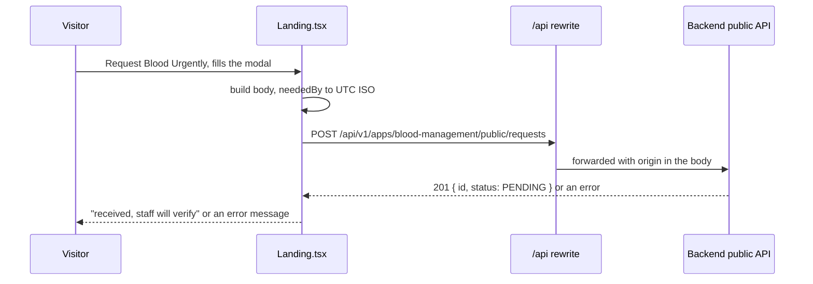

# Flow: a visitor requests blood

1. The visitor opens the modal and fills the fields (see [request blood](../features/request-blood.md)).
2. On submit the button shows a busy state; the body is `{ origin, patientName, hospital, district, bloodGroup, units, urgency, neededBy, contactName, contactPhone, reason }` with the group mapped from `O+` to `O_POS`.
3. The backend validates, normalises the phone and stores a **PENDING** request with source PUBLIC.
4. The site shows the success panel. Nothing appears in the public list yet.
5. Staff verify the request in the admin panel (repo `blood-managment-admin`, `docs/_shared/flows/request-handling.md`). After the landing page cache refreshes (30 to 60 seconds), the request shows under Live Emergency Requests.

Errors: 422 "check your details"; 429 "too many attempts"; other failures a generic message. The request is never shown or retried automatically.
